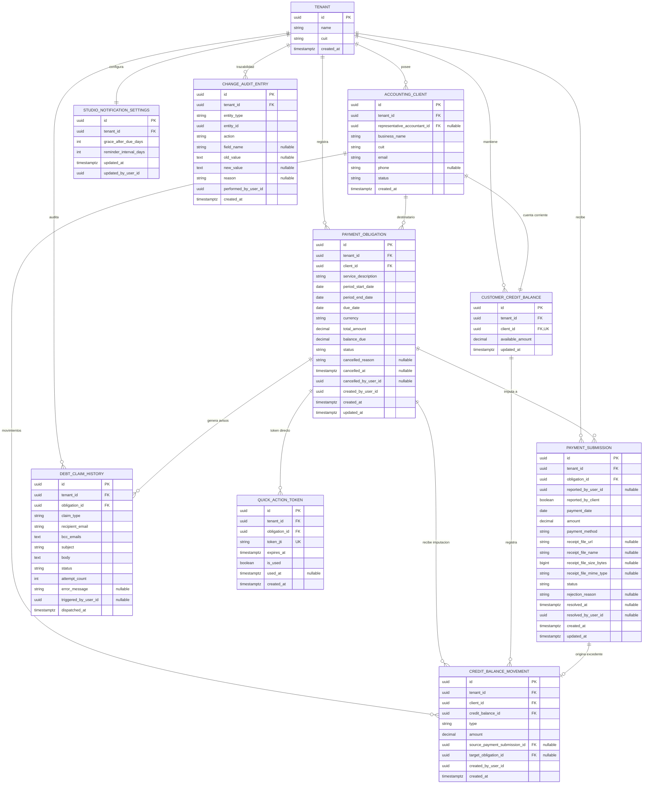
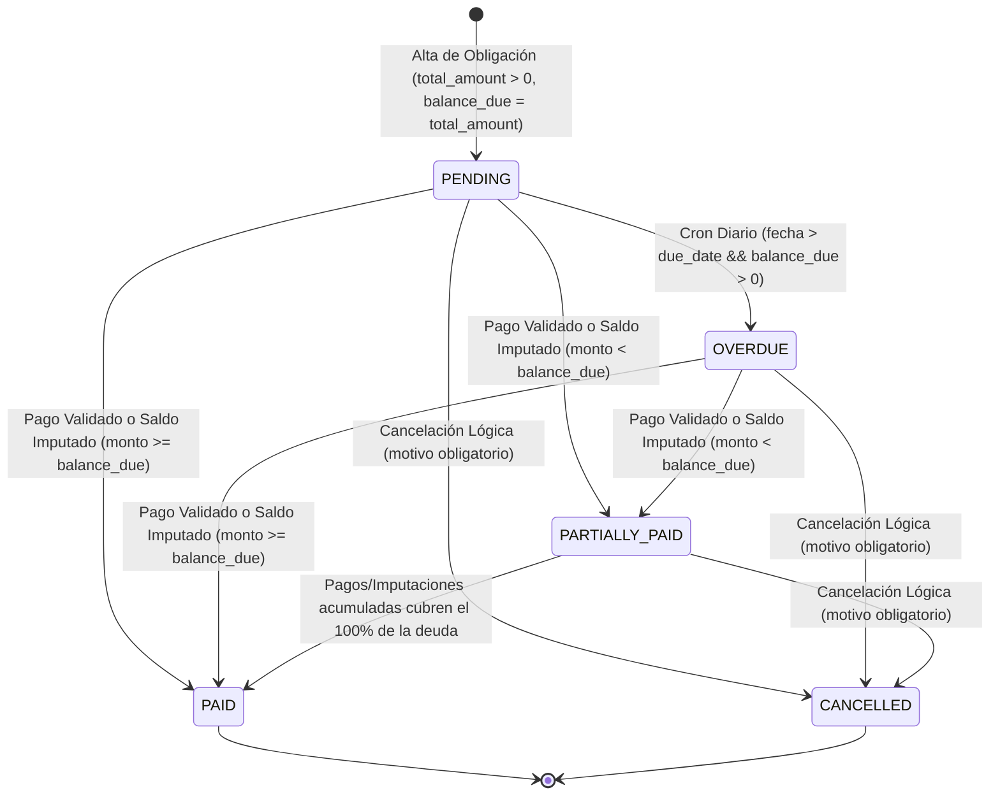
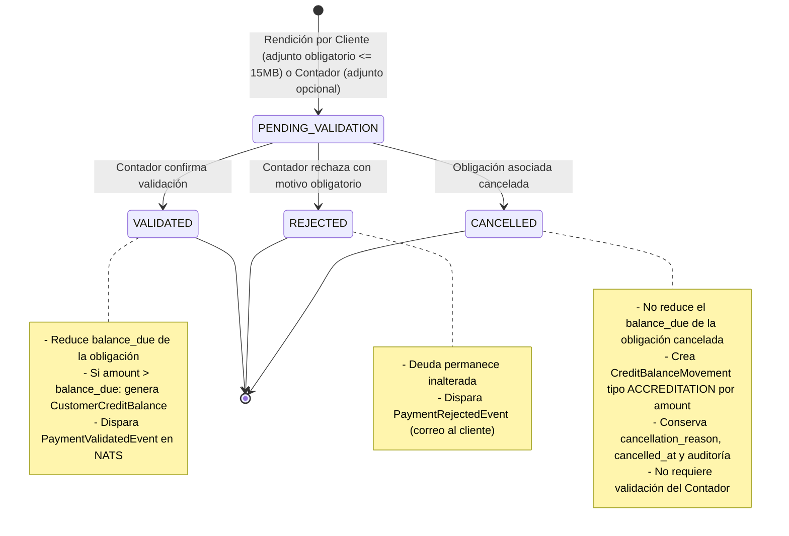

# Data Model: Sistema de Gestión de Cobranzas y Flujo de Fondos v1.0

**Branch**: `001-cobranzas-flujo-fondos` | **Date**: 2026-10-30 | **Spec**: [spec.md](./spec.md)

Este documento define el modelo de entidades, relaciones, invariantes de validación, máquinas de estado y políticas de Row-Level Security (RLS) en PostgreSQL para el módulo de cobranzas y flujo de fondos.

---

## 1. Diagrama Entidad-Relación (ERD)



---

## 2. Entidades y Esquema Detallado

### 2.1 `Tenant` (Estudio Contable)

Representa la unidad de inquilino (tenant) aislada en la base de datos compartida.

| Campo        | Tipo           | Nulo | Descripción                                                |
| ------------ | -------------- | :--: | ---------------------------------------------------------- |
| `id`         | `UUID`         |  No  | Clave primaria. Coincide con `client_id` OIDC de Keycloak. |
| `name`       | `VARCHAR(150)` |  No  | Razón social o denominación del estudio contable.          |
| `cuit`       | `VARCHAR(11)`  |  No  | CUIT tributario argentino (sin guiones).                   |
| `created_at` | `TIMESTAMPTZ`  |  No  | Timestamp de creación. Default: `NOW()`.                   |

---

### 2.2 `StudioNotificationSettings` (Parámetros del Estudio)

Configuración global de reclamos automáticos por estudio (FR-004, D-006).

| Campo                    | Tipo          | Nulo | Restricciones / Reglas                                                      |
| ------------------------ | ------------- | :--: | --------------------------------------------------------------------------- |
| `id`                     | `UUID`        |  No  | Clave primaria (`gen_random_uuid()`).                                       |
| `tenant_id`              | `UUID`        |  No  | FK a `Tenant.id`. Índice único (`1:1`).                                     |
| `grace_after_due_days`   | `INT`         |  No  | Días tras vencimiento para el 1er aviso. Default: `1`. Min: `0`, Max: `30`. |
| `reminder_interval_days` | `INT`         |  No  | Intervalo de reiteración en días. Default: `7`. Min: `1`, Max: `60`.        |
| `updated_at`             | `TIMESTAMPTZ` |  No  | Fecha de última actualización.                                              |
| `updated_by_user_id`     | `UUID`        |  No  | Identificador del `STUDIO_ADMIN` que modificó la configuración.             |

---

### 2.3 `AccountingClient` (Cliente del Estudio)

Padrón de clientes receptores de servicios contables del estudio.

| Campo                          | Tipo           | Nulo | Restricciones / Reglas                                                                           |
| ------------------------------ | -------------- | :--: | ------------------------------------------------------------------------------------------------ |
| `id`                           | `UUID`         |  No  | Clave primaria.                                                                                  |
| `tenant_id`                    | `UUID`         |  No  | FK a `Tenant.id`. Columna discriminadora RLS.                                                    |
| `representative_accountant_id` | `UUID`         |  Sí  | FK al usuario Contador asignado. Si es `NULL`, los avisos copian a los Administradores (CL-004). |
| `business_name`                | `VARCHAR(200)` |  No  | Razón social o nombre completo del cliente.                                                      |
| `cuit`                         | `VARCHAR(11)`  |  No  | CUIT argentino validado por algoritmo AFIP.                                                      |
| `email`                        | `VARCHAR(255)` |  No  | Dirección de correo destinataria principal de avisos y notificaciones.                           |
| `phone`                        | `VARCHAR(50)`  |  Sí  | Teléfono de contacto de soporte.                                                                 |
| `status`                       | `VARCHAR(20)`  |  No  | `ACTIVE` \| `INACTIVE`. Default: `ACTIVE`.                                                       |
| `created_at`                   | `TIMESTAMPTZ`  |  No  | Timestamp de alta.                                                                               |

---

### 2.4 `PaymentObligation` (Obligación de Cobro)

Compromiso de pago formalizado para un cliente por un servicio profesional (FR-001, FR-002).

| Campo                  | Tipo            | Nulo | Restricciones / Reglas                                                           |
| ---------------------- | --------------- | :--: | -------------------------------------------------------------------------------- |
| `id`                   | `UUID`          |  No  | Clave primaria (`gen_random_uuid()`).                                            |
| `tenant_id`            | `UUID`          |  No  | FK a `Tenant.id`. Columna discriminadora RLS.                                    |
| `client_id`            | `UUID`          |  No  | FK a `AccountingClient.id`.                                                      |
| `service_description`  | `VARCHAR(300)`  |  No  | Descripción del servicio profesional prestado.                                   |
| `period_start_date`    | `DATE`          |  No  | Inicio del período fiscal/servicio facturado.                                    |
| `period_end_date`      | `DATE`          |  No  | Fin del período fiscal/servicio facturado (`>= period_start_date`).              |
| `due_date`             | `DATE`          |  No  | Fecha límite estricta de pago.                                                   |
| `currency`             | `VARCHAR(3)`    |  No  | Fijo: `ARS`. No negociable (Principio VII).                                      |
| `total_amount`         | `DECIMAL(14,2)` |  No  | Importe nominal total emitido. Check: `total_amount > 0`.                        |
| `balance_due`          | `DECIMAL(14,2)` |  No  | Saldo deudor remanente pendiente. Check: `balance_due >= 0` y `<= total_amount`. |
| `status`               | `VARCHAR(20)`   |  No  | Enum: `PENDING`, `OVERDUE`, `PAID`, `PARTIALLY_PAID`, `CANCELLED`.               |
| `cancelled_reason`     | `TEXT`          |  Sí  | Obligatorio si `status == 'CANCELLED'`. Prohibido borrado físico (FR-014).       |
| `cancelled_at`         | `TIMESTAMPTZ`   |  Sí  | Fecha y hora de cancelación lógica.                                              |
| `cancelled_by_user_id` | `UUID`          |  Sí  | Identificador del usuario que ejecutó la cancelación.                            |
| `created_by_user_id`   | `UUID`          |  No  | Identificador del Contador que registró la obligación.                           |
| `created_at`           | `TIMESTAMPTZ`   |  No  | Fecha de creación.                                                               |
| `updated_at`           | `TIMESTAMPTZ`   |  No  | Fecha de última modificación.                                                    |

---

### 2.5 `PaymentSubmission` (Rendición de Pago Informado)

Declaración de pago efectuada por un cliente o asentada por un contador (FR-008, FR-009, FR-010, FR-011).

| Campo                     | Tipo            | Nulo | Restricciones / Reglas                                                                                                                                                                                           |
| ------------------------- | --------------- | :--: | ---------------------------------------------------------------------------------------------------------------------------------------------------------------------------------------------------------------- |
| `id`                      | `UUID`          |  No  | Clave primaria.                                                                                                                                                                                                  |
| `tenant_id`               | `UUID`          |  No  | FK a `Tenant.id`. Columna discriminadora RLS.                                                                                                                                                                    |
| `obligation_id`           | `UUID`          |  No  | FK a `PaymentObligation.id`.                                                                                                                                                                                     |
| `reported_by_user_id`     | `UUID`          |  Sí  | ID del usuario autenticado que reporta (null si viene por QuickActionToken).                                                                                                                                     |
| `reported_by_client`      | `BOOLEAN`       |  No  | `true` si reportó el cliente; `false` si reportó el contador.                                                                                                                                                    |
| `payment_date`            | `DATE`          |  No  | Fecha en la que se efectuó el pago.                                                                                                                                                                              |
| `amount`                  | `DECIMAL(14,2)` |  No  | Importe informado. Check: `amount > 0`.                                                                                                                                                                          |
| `payment_method`          | `VARCHAR(20)`   |  No  | Enum: `TRANSFER`, `DEPOSIT`, `CASH`, `OTHER`.                                                                                                                                                                    |
| `receipt_file_url`        | `VARCHAR(500)`  |  Sí  | URL del objeto en MinIO/S3. Obligatorio si `reported_by_client == true`.                                                                                                                                         |
| `receipt_file_name`       | `VARCHAR(255)`  |  Sí  | Nombre original del archivo adjunto.                                                                                                                                                                             |
| `receipt_file_size_bytes` | `BIGINT`        |  Sí  | Tamaño exacto en bytes. Check: `<= 15728640` (15.00 MB exactos, CL-001).                                                                                                                                         |
| `receipt_file_mime_type`  | `VARCHAR(100)`  |  Sí  | Mime-type (`application/pdf`, `image/png`, `image/jpeg`).                                                                                                                                                        |
| `status`                  | `VARCHAR(25)`   |  No  | Enum: `PENDING_VALIDATION`, `VALIDATED`, `REJECTED`, `CANCELLED`. Default: `PENDING_VALIDATION`. `CANCELLED` se asigna automáticamente cuando se cancela la obligación asociada mientras el pago está pendiente. |
| `rejection_reason`        | `TEXT`          |  Sí  | Obligatorio si `status == 'REJECTED'`.                                                                                                                                                                           |
| `cancellation_reason`     | `TEXT`          |  Sí  | Motivo de cancelación. Obligatorio si `status == 'CANCELLED'`; para cancelación por obligación, referencia el motivo de la obligación cancelada.                                                                 |
| `resolved_at`             | `TIMESTAMPTZ`   |  Sí  | Fecha y hora de resolución (validación o rechazo).                                                                                                                                                               |
| `resolved_by_user_id`     | `UUID`          |  Sí  | ID del Contador que validó o rechazó.                                                                                                                                                                            |
| `cancelled_at`            | `TIMESTAMPTZ`   |  Sí  | Fecha y hora de cancelación lógica.                                                                                                                                                                              |
| `cancelled_by_user_id`    | `UUID`          |  Sí  | ID del usuario que canceló directamente; `NULL` cuando la cancelación es automática por cancelación de la obligación.                                                                                            |
| `created_at`              | `TIMESTAMPTZ`   |  No  | Timestamp de rendición.                                                                                                                                                                                          |
| `updated_at`              | `TIMESTAMPTZ`   |  No  | Timestamp de actualización.                                                                                                                                                                                      |

---

### 2.6 `CustomerCreditBalance` y `CreditBalanceMovement` (Saldos a Favor)

Gestión inmutable y auditable del saldo a favor del cliente (FR-012, FR-013, D-008).

**Tabla `CustomerCreditBalance`**:

| Campo              | Tipo            | Nulo | Restricciones / Reglas                                                       |
| ------------------ | --------------- | :--: | ---------------------------------------------------------------------------- |
| `id`               | `UUID`          |  No  | Clave primaria.                                                              |
| `tenant_id`        | `UUID`          |  No  | FK a `Tenant.id`.                                                            |
| `client_id`        | `UUID`          |  No  | FK a `AccountingClient.id`. Índice único (`1:1`).                            |
| `available_amount` | `DECIMAL(14,2)` |  No  | Saldo disponible acumulado. Check: `available_amount >= 0`. Default: `0.00`. |
| `updated_at`       | `TIMESTAMPTZ`   |  No  | Timestamp de última variación.                                               |

**Tabla `CreditBalanceMovement`**:

| Campo                          | Tipo            | Nulo | Restricciones / Reglas                                                                                                             |
| ------------------------------ | --------------- | :--: | ---------------------------------------------------------------------------------------------------------------------------------- |
| `id`                           | `UUID`          |  No  | Clave primaria.                                                                                                                    |
| `tenant_id`                    | `UUID`          |  No  | FK a `Tenant.id`.                                                                                                                  |
| `client_id`                    | `UUID`          |  No  | FK a `AccountingClient.id`.                                                                                                        |
| `credit_balance_id`            | `UUID`          |  No  | FK a `CustomerCreditBalance.id`.                                                                                                   |
| `type`                         | `VARCHAR(20)`   |  No  | Enum: `ACCREDITATION` (ingreso por excedente) \| `APPLICATION` (imputación a deuda).                                               |
| `amount`                       | `DECIMAL(14,2)` |  No  | Importe del movimiento. Check: `amount > 0`.                                                                                       |
| `source_payment_submission_id` | `UUID`          |  Sí  | FK a `PaymentSubmission.id` si `type == 'ACCREDITATION'`.                                                                          |
| `target_obligation_id`         | `UUID`          |  Sí  | FK a `PaymentObligation.id` si `type == 'APPLICATION'`.                                                                            |
| `created_by_user_id`           | `UUID`          |  Sí  | Identificador del Contador que validó o imputó; `NULL` cuando el movimiento se crea automáticamente por cancelación de obligación. |
| `created_at`                   | `TIMESTAMPTZ`   |  No  | Timestamp inmutable de registro.                                                                                                   |

---

### 2.7 `DebtClaimHistory` (Historial de Reclamos de Deuda)

Registro inmutable de correos emitidos y auditoría de reintentos (FR-007, D-005).

| Campo                  | Tipo           | Nulo | Restricciones / Reglas                                               |
| ---------------------- | -------------- | :--: | -------------------------------------------------------------------- |
| `id`                   | `UUID`         |  No  | Clave primaria.                                                      |
| `tenant_id`            | `UUID`         |  No  | FK a `Tenant.id`.                                                    |
| `obligation_id`        | `UUID`         |  No  | FK a `PaymentObligation.id`.                                         |
| `claim_type`           | `VARCHAR(20)`  |  No  | Enum: `AUTOMATIC` \| `MANUAL`.                                       |
| `recipient_email`      | `VARCHAR(255)` |  No  | Correo del cliente.                                                  |
| `bcc_emails`           | `TEXT`         |  No  | JSON o lista separada por comas de casillas en copia oculta.         |
| `subject`              | `VARCHAR(250)` |  No  | Asunto del mensaje.                                                  |
| `body`                 | `TEXT`         |  No  | Cuerpo del correo (HTML/Texto renderizado).                          |
| `status`               | `VARCHAR(20)`  |  No  | Enum: `SENT` \| `FAILED`.                                            |
| `attempt_count`        | `INT`          |  No  | Cantidad de intentos de envío realizados (mínimo 1, reintento auto). |
| `error_message`        | `TEXT`         |  Sí  | Detalle del error SMTP en caso de `status == 'FAILED'`.              |
| `triggered_by_user_id` | `UUID`         |  Sí  | `NULL` para reclamo automático; ID del Contador para reclamo manual. |
| `dispatched_at`        | `TIMESTAMPTZ`  |  No  | Timestamp del despacho o registro de fallo.                          |

---

### 2.8 `QuickActionToken` (Token de Acción Rápida)

Tokens firmados para enlace directo en correos de reclamo (FR-008b, D-004).

| Campo           | Tipo          | Nulo | Restricciones / Reglas                                  |
| --------------- | ------------- | :--: | ------------------------------------------------------- |
| `id`            | `UUID`        |  No  | Clave primaria.                                         |
| `tenant_id`     | `UUID`        |  No  | FK a `Tenant.id`.                                       |
| `obligation_id` | `UUID`        |  No  | FK a `PaymentObligation.id`.                            |
| `token_jti`     | `VARCHAR(64)` |  No  | Identificador único de token (`jti`). Índice único.     |
| `expires_at`    | `TIMESTAMPTZ` |  No  | Timestamp de expiración (24 horas desde emisión).       |
| `is_used`       | `BOOLEAN`     |  No  | `false` inicial. Pasa a `true` tras primer uso exitoso. |
| `used_at`       | `TIMESTAMPTZ` |  Sí  | Timestamp en el que se consumió el token.               |
| `created_at`    | `TIMESTAMPTZ` |  No  | Timestamp de emisión.                                   |

---

### 2.9 `ChangeAuditEntry` (Auditoría de Modificaciones)

Trazabilidad inmutable de cambios en importes, fechas y cancelaciones lógicas (FR-014).

| Campo                  | Tipo          | Nulo | Restricciones / Reglas                                                 |
| ---------------------- | ------------- | :--: | ---------------------------------------------------------------------- |
| `id`                   | `UUID`        |  No  | Clave primaria.                                                        |
| `tenant_id`            | `UUID`        |  No  | FK a `Tenant.id`.                                                      |
| `entity_type`          | `VARCHAR(50)` |  No  | `PaymentObligation`, `PaymentSubmission`, etc.                         |
| `entity_id`            | `UUID`        |  No  | Identificador de la entidad afectada.                                  |
| `action`               | `VARCHAR(20)` |  No  | `CREATE`, `UPDATE`, `CANCEL`.                                          |
| `field_name`           | `VARCHAR(50)` |  Sí  | Nombre del campo alterado (e.g. `status`, `total_amount`, `due_date`). |
| `old_value`            | `TEXT`        |  Sí  | Valor previo a la modificación.                                        |
| `new_value`            | `TEXT`        |  Sí  | Nuevo valor tras la modificación.                                      |
| `reason`               | `TEXT`        |  Sí  | Motivo justificado (obligatorio en bajas/cancelaciones).               |
| `performed_by_user_id` | `UUID`        |  No  | Usuario que ejecutó la mutación.                                       |
| `created_at`           | `TIMESTAMPTZ` |  No  | Timestamp inmutable. Default: `NOW()`.                                 |

---

## 3. Máquinas de Estados y Transiciones

### 3.1 Ciclo de Vida de `PaymentObligation`



### 3.2 Ciclo de Vida de `PaymentSubmission`



---

## 4. Políticas de Row-Level Security (PostgreSQL RLS)

Todas las tablas pertenecientes al tenant deben aplicar obligatoriamente RLS:

```sql
-- Función auxiliar para verificar tenant de sesión
CREATE OR REPLACE FUNCTION current_tenant_id() RETURNS uuid AS $$
BEGIN
  RETURN NULLIF(current_setting('app.current_tenant', true), '')::uuid;
END;
$$ LANGUAGE plpgsql STABLE;

-- Activación de RLS para PaymentObligation
ALTER TABLE public.payment_obligations ENABLE ROW LEVEL SECURITY;
ALTER TABLE public.payment_obligations FORCE ROW LEVEL SECURITY;

CREATE POLICY tenant_isolation_payment_obligations ON public.payment_obligations
  FOR ALL
  USING (tenant_id = current_tenant_id())
  WITH CHECK (tenant_id = current_tenant_id());

-- Activación de RLS para PaymentSubmission
ALTER TABLE public.payment_submissions ENABLE ROW LEVEL SECURITY;
ALTER TABLE public.payment_submissions FORCE ROW LEVEL SECURITY;

CREATE POLICY tenant_isolation_payment_submissions ON public.payment_submissions
  FOR ALL
  USING (tenant_id = current_tenant_id())
  WITH CHECK (tenant_id = current_tenant_id());

-- Activación de RLS para CustomerCreditBalance
ALTER TABLE public.customer_credit_balances ENABLE ROW LEVEL SECURITY;
ALTER TABLE public.customer_credit_balances FORCE ROW LEVEL SECURITY;

CREATE POLICY tenant_isolation_customer_credit_balances ON public.customer_credit_balances
  FOR ALL
  USING (tenant_id = current_tenant_id())
  WITH CHECK (tenant_id = current_tenant_id());

-- Activación de RLS para CreditBalanceMovement
ALTER TABLE public.credit_balance_movements ENABLE ROW LEVEL SECURITY;
ALTER TABLE public.credit_balance_movements FORCE ROW LEVEL SECURITY;

CREATE POLICY tenant_isolation_credit_balance_movements ON public.credit_balance_movements
  FOR ALL
  USING (tenant_id = current_tenant_id())
  WITH CHECK (tenant_id = current_tenant_id());

-- Activación de RLS para DebtClaimHistory
ALTER TABLE public.debt_claim_histories ENABLE ROW LEVEL SECURITY;
ALTER TABLE public.debt_claim_histories FORCE ROW LEVEL SECURITY;

CREATE POLICY tenant_isolation_debt_claim_histories ON public.debt_claim_histories
  FOR ALL
  USING (tenant_id = current_tenant_id())
  WITH CHECK (tenant_id = current_tenant_id());
```

---

## 5. Invariantes y Validaciones de Negocio

1. **Aritmética de Deuda**: `balance_due = total_amount - SUM(validated_payments) - SUM(applied_credits)`.
2. **Cálculo de Excedente**: Si `validated_payment_amount > obligation.balance_due`:
   - `obligation.balance_due` pasa a `0.00`.
   - `surplus = validated_payment_amount - obligation.balance_due`.
   - Se crea `CreditBalanceMovement` tipo `ACCREDITATION` por `surplus`.
   - `CustomerCreditBalance.available_amount += surplus`.
3. **Imputación de Crédito**:
   - `amount_to_apply <= CustomerCreditBalance.available_amount` y `<= obligation.balance_due`.
   - Se crea `CreditBalanceMovement` tipo `APPLICATION` por `amount_to_apply`.
   - `CustomerCreditBalance.available_amount -= amount_to_apply`.
   - `obligation.balance_due -= amount_to_apply`.
4. **Validación de Archivos (CL-001)**:
   - Tamaño máximo admisible: `15 * 1024 * 1024 = 15.728.640 bytes`.
   - Rechazo inmediato con código 400 y RFC 7807 si el payload excede este límite.
5. **No Borrado Físico (FR-014)**:
   - Prohibido emitir sentencias SQL `DELETE` sobre `payment_obligations` y `payment_submissions`.
   - Toda baja debe realizarse mediante mutación a estado `CANCELLED` con inserción simultánea en `change_audit_entries`.
6. **Cancelación de obligación con pagos pendientes (FR-009, FR-014)**:
   - Al cancelar una obligación, cada `PaymentSubmission` en estado `PENDING_VALIDATION` debe pasar atómicamente a `CANCELLED`.
   - Por cada pago cancelado se crea un `CreditBalanceMovement` tipo `ACCREDITATION` por el importe completo del pago y se incrementa `CustomerCreditBalance.available_amount`.
   - La operación no modifica `PaymentObligation.balance_due`, no requiere validación del Contador y registra auditoría para la obligación, cada pago y cada movimiento de crédito.
